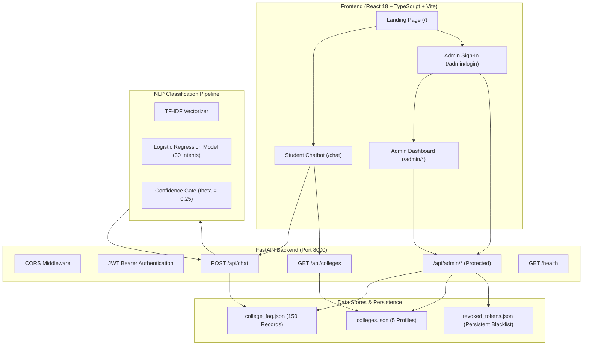

# SmartCollege AI — Multi-College Student Chatbot & Administrative Platform

SmartCollege AI is a production-grade, full-stack web platform designed to streamline student query resolution across multiple higher education institutions. The system provides an AI-powered conversational chatbot for students with **strict institutional data isolation**, **source-verified answers**, and transparent **`PENDING_VERIFICATION`** notifications, paired with an enterprise **Administrative Management Console** for live institutional profile and FAQ curation.

---

## 1. Problem Statement

Prospective and enrolled college students frequently encounter friction when seeking vital institutional information:
- Information regarding admissions, fee structures, hostel accommodations, scholarships, and placements is often scattered across disparate PDF circulars, outdated web pages, or separate portals.
- Generic AI chatbots frequently hallucinate or blend data across different institutions, generating misleading or inaccurate answers.
- Institutions lack a unified administrative interface to audit, update, and toggle the verification status of student-facing FAQs in real time without retraining machine learning models or redeploying backend infrastructure.

---

## 2. Project Objectives

1. **Strict Multi-College Isolation:** Guarantee that query responses and institutional records for different colleges never blend, cross-pollinate, or leak into one another.
2. **Verification Transparency:** Back every verified student answer with official university citations and audited timestamps, while explicitly flagging unconfirmed categories as `PENDING_VERIFICATION`.
3. **Decoupled Machine Learning Pipeline:** Train an intent recognition classifier that handles natural student language independently from institutional datasets, eliminating the need for retraining when FAQs are added or updated.
4. **Secure Administrative Governance:** Provide role-based administrative access protected by PBKDF2 password hashing, signed HS256 JWT tokens, and persistent revocation to manage college profiles and FAQ records.
5. **Real-Time Data Reactivity:** Enable administrative FAQ edits and verification toggles to reflect immediately in the student chatbot with zero restart or caching delays.

---

## 3. Main Features

### 3.1 Student Chatbot Portal (`/` & `/chat`)
- **Institution Switcher:** Seamlessly switch between five verified Andhra Pradesh colleges with automated conversation context reset to maintain strict isolation.
- **Natural Language Understanding:** Pre-trained TF-IDF character n-gram + Logistic Regression pipeline classifying student queries across 30 intents.
- **Source Citations:** Clickable official portal links and last-verified audit dates on every verified answer.
- **Student Answer Feedback:** Thumbs up / thumbs down controls on assistant answers, structured issue reason reporting (`Incorrect answer`, `Outdated information`, `Irrelevant answer`, `Incomplete answer`, `Other`), optional text comment submission, duplicate prevention per session + message, and dynamic rating updates.
- **Chat Sharing & Copying:** One-click copy for individual answers with official source citations, complete conversation transcript copying, and Web Share API integration with automatic clipboard fallback.
- **Multi-Format Chat Export:** Download current or past conversations directly as formatted `.txt` files or styled multi-page `.pdf` documents with institutional branding and citations.
- **Exploratory Question Chips:** Dynamic category chips and suggested questions to guide prospective students.
- **College-Scoped FAQ Browser:** Searchable modal dialog displaying all curated FAQs for the selected college.
- **Voice Recognition (Speech-to-Text):** Integrated Web Speech API support (`en-IN` default) with pre-submission text editing.
- **Persistent Chat History:** Client-side conversation preservation across browser refreshes with clear chat capabilities and direct PDF/TXT export options.

### 3.2 Administrator Management Console (`/admin`)
- **Dedicated Admin Authentication (`/admin/login`):** Protected sign-in screen with password visibility toggling, loading indicators, and informative error handling.
- **Dashboard Overview (`/admin`):** Live KPI metric cards displaying total colleges, total FAQs, verified count, pending count, institutional verification breakdown table, and quick access to chat testing and feedback management.
- **College Management (`/admin/colleges`):** Comprehensive institutional profile inspection, live search, registration modal for new colleges, profile editing, and safe deletion with relational dependency protection.
- **FAQ Management (`/admin/faqs`):** Full-featured data table with instant multi-criteria filtering (college, category, verification status, and text search), pagination, one-click verification status toggles, new FAQ creation with duplicate detection (409 Conflict), and deletion confirmation dialogs.
- **Feedback Management Console (`/admin/feedback`):** Dedicated administrative console with satisfaction rate KPIs, filterable and searchable feedback table, detailed Q&A modal inspection, and four-state resolution workflow (`NEW`, `REVIEWED`, `RESOLVED`, `DISMISSED`) with internal notes.

---

## 4. Supported Institutions

SmartCollege AI actively maintains 150 strictly partitioned FAQ records (30 per institution) across five premier Andhra Pradesh colleges:

1. **Dr. RVR NRI Institute of Technology (`college_001` / `NRIU`):** Agiripalli, Eluru District, AP.
2. **SRM University-AP (`college_002` / `SRMAP`):** Neerukonda, Mangalagiri, AP.
3. **Koneru Lakshmaiah Education Foundation (`college_003` / `KLU`):** Vaddeswaram, Guntur District, AP.
4. **Siddhartha Academy of Higher Education (`college_004` / `SAHE`):** Kanuru, Vijayawada, AP.
5. **Prasad V Potluri Siddhartha Institute of Technology (`college_005` / `PVPSIT`):** Kanuru, Vijayawada, AP.

> [!IMPORTANT]
> **SAHE and PVPSIT Non-Merger Guarantee:**  
> Although both institutions share historical legacy ties with the Siddhartha Academy sponsoring body in Vijayawada, they operate under distinct administrative charters, independent university accreditations, and separate official portals (`siddhartha.edu.in` vs. `pvpsiddhartha.ac.in`). SmartCollege AI strictly isolates their datasets, profiles, and queries.

---

## 5. Technology Stack

### Frontend
- **Framework:** React 18 with TypeScript
- **Build Tool:** Vite 5
- **UI Components:** Material UI (MUI v6) & Emotion
- **Routing:** React Router v6 (with Route Guards)
- **HTTP Client:** Axios (with Bearer token interceptors)
- **Testing:** Vitest & React Testing Library

### Backend
- **Framework:** FastAPI (ASGI Python web framework)
- **Server:** Uvicorn
- **Data Validation:** Pydantic v2 & Pydantic-Settings
- **Security & Auth:** PyJWT (HS256 tokens) & Passlib/PBKDF2-SHA256 password hashing
- **Data Persistence:** Thread-safe Atomic JSON Data Store with fallback-free locking; SQLAlchemy 2.0 PostgreSQL readiness
- **Testing:** Pytest & HTTPX

### Machine Learning & NLP
- **Feature Extraction:** Scikit-learn Character n-gram TF-IDF Vectorizer (`ngram_range=(2, 5)`)
- **Classification:** Multi-class Logistic Regression with balanced class weights
- **Serialization:** Joblib

---

## 6. System Architecture



---

## 7. Folder Structure

```text
AI-Student-Chatbot/
├── .gitignore
├── README.md
├── backend/
│   ├── .env.example                     # Backend environment template
│   ├── requirements.txt                 # Pinned Python dependencies
│   ├── app/
│   │   ├── main.py                      # FastAPI application entry & CORS
│   │   ├── models/                      # Joblib models, vectorizers & metadata
│   │   ├── routes/                      # health, colleges, chat, admin, admin_auth
│   │   ├── services/                    # ChatbotService, JsonDataStore, PostgresDataStore
│   │   └── utils/                       # Security, config, schemas, dependencies
│   └── tests/                           # 111 pytest unit & integration tests
├── dataset/
│   ├── raw/                             # Original uncleaned intents & models
│   └── processed/                       # 5 colleges.json, 150 college_faq.json, student_intents.json
├── docs/                                # Technical reports, architecture & setup guides
└── frontend/
    ├── .env.example                     # Frontend environment template
    ├── package.json                     # NPM packages & build scripts
    ├── vite.config.ts                   # Vite configuration with chunk splitting
    ├── public/logos/                    # Logos for college_001 to college_005
    └── src/
        ├── assets/                      # SVGs, icons, branding
        ├── components/                  # ChatWindow, Sidebar, CollegeSelector, etc.
        ├── contexts/                    # CollegeContext, AdminAuthContext
        ├── layouts/                     # MainLayout (Student), AdminLayout (Admin)
        ├── pages/                       # LandingPage, ChatPage, Admin pages
        ├── services/                    # Axios API client, adminService, chatService
        └── __tests__/                   # 18 Vitest unit & component test suites
```

---

## 8. Installation & Setup Instructions

### Prerequisites
- **Python:** `3.11+` (tested on Python `3.14.3`)
- **Node.js & npm:** Node `18+` or `20+` (tested on Node `24.13.0` / npm `11.16.0`)

---

### Step 1: Backend Setup

1. Open a terminal in the project directory:
   ```powershell
   cd D:\TechGlobal_Mini\AI-Student-Chatbot
   ```
2. Create and activate a Python virtual environment:
   ```powershell
   python -m venv .venv
   .\.venv\Scripts\Activate.ps1
   ```
3. Install dependencies:
   ```powershell
   pip install -r backend/requirements.txt
   ```
4. Configure environment variables:
   ```powershell
   cp backend/.env.example backend/.env
   ```
   Open `backend/.env` and configure your admin credentials and JWT secret:
   ```env
   FAQ_BACKEND=json
   CONFIDENCE_THRESHOLD=0.25
   ADMIN_USERNAME=admin
   ADMIN_PASSWORD=YourSecurePassword2026!
   ADMIN_JWT_SECRET=4f9b2d8e1a7c3f5e9a0b1c2d3e4f5a6b7c8d9e0f1a2b3c4d5e6f7a8b9c0d1e2f
   ```
   *To generate a 64-character JWT secret: `python -c "import secrets; print(secrets.token_hex(32))"`*

---

### Step 2: Frontend Setup

1. Open a second terminal in `frontend/`:
   ```powershell
   cd D:\TechGlobal_Mini\AI-Student-Chatbot\frontend
   ```
2. Install npm dependencies:
   ```powershell
   npm install
   ```
3. Configure environment variables:
   ```powershell
   cp .env.example .env
   ```
   Ensure `frontend/.env` contains:
   ```env
   VITE_API_BASE_URL=http://127.0.0.1:8000
   ```

---

## 9. Running the Application Locally

Start both servers concurrently:

### Terminal 1 — Backend (FastAPI)
```powershell
cd D:\TechGlobal_Mini\AI-Student-Chatbot
$env:PYTHONPATH="D:\TechGlobal_Mini\AI-Student-Chatbot"
python -m uvicorn backend.app.main:app --host 127.0.0.1 --port 8000 --reload
```
- **Backend API Root:** `http://127.0.0.1:8000/`
- **Interactive Swagger Docs:** `http://127.0.0.1:8000/docs`
- **Health Check:** `http://127.0.0.1:8000/health`

### Terminal 2 — Frontend (React + Vite)
```powershell
cd D:\TechGlobal_Mini\AI-Student-Chatbot\frontend
npm run dev
```
- **Student Portal:** `http://127.0.0.1:5173/` or `http://127.0.0.1:5173/chat`
- **Admin Sign-In:** `http://127.0.0.1:5173/admin/login`
- **Admin Console:** `http://127.0.0.1:5173/admin`

---

## 10. API Overview

| Method | Endpoint | Access | Purpose |
| :--- | :--- | :--- | :--- |
| `GET` | `/health` | Public | System status, intent threshold, and dataset counts |
| `GET` | `/api/colleges` | Public | List all 5 registered colleges |
| `POST` | `/api/colleges/select` | Public | Validate and switch active college with context reset |
| `GET` | `/api/colleges/{id}/faqs` | Public | Retrieve strictly college-scoped FAQs |
| `POST` | `/api/chat` | Public | Predict intent and return verified FAQ or pending notice |
| `POST` | `/api/admin/auth/login` | Public | Authenticate admin and return signed JWT token |
| `GET` | `/api/admin/auth/me` | Bearer | Inspect currently active admin identity |
| `POST` | `/api/admin/auth/logout` | Bearer | Revoke token and persist JTI to blacklist |
| `GET` | `/api/admin/overview` | Bearer | Live KPI statistics across colleges and FAQs |
| `GET` | `/api/admin/colleges` | Bearer | List colleges for administration |
| `POST` | `/api/admin/colleges` | Bearer | Register a new college profile |
| `PUT` | `/api/admin/colleges/{id}`| Bearer | Update college profile information |
| `DELETE` | `/api/admin/colleges/{id}`| Bearer | Delete college (enforces zero-FAQ constraint) |
| `GET` | `/api/admin/faqs` | Bearer | List FAQs with filters, search, and pagination |
| `POST` | `/api/admin/faqs` | Bearer | Create a new FAQ (with duplicate detection) |
| `PUT` | `/api/admin/faqs/{id}` | Bearer | Update existing FAQ text or metadata |
| `PATCH` | `/api/admin/faqs/{id}/verification` | Bearer | One-click toggle between VERIFIED and PENDING |
| `DELETE` | `/api/admin/faqs/{id}` | Bearer | Delete an FAQ record with confirmation |

---

## 11. Testing & Verification

### Run Backend Tests (Pytest)
```powershell
cd D:\TechGlobal_Mini\AI-Student-Chatbot
python -m pytest backend/tests -v
```
*Result: **111 passed, 0 failed** in 1.68s.*

### Run Frontend Tests (Vitest)
```powershell
cd D:\TechGlobal_Mini\AI-Student-Chatbot\frontend
npm test -- --run
```
*Result: **18 passed, 0 failed** across 4 test suites.*

### Run Static Analysis & Production Build
```powershell
cd D:\TechGlobal_Mini\AI-Student-Chatbot\frontend
npx tsc -b
npm run build
```
*Result: **0 compiler errors**, production bundle created in `frontend/dist/` in 17.68s.*

---

## 12. Screenshots & User Experience Walkthrough

### 12.1 Student Portal
- **Landing Page (`/`):** Hero section with institutional badges, key features, and one-click college entrance cards.
- **Chat Assistant (`/chat`):** Clean messaging stream with avatar identifiers, clickable official source citations, verified/pending chips, suggested question chips, and voice input controls.
- **College Switcher:** Header dropdown with official college logos, automatically clearing chat history to prevent cross-institutional data confusion.

### 12.2 Administrative Console
- **Admin Sign-In (`/admin/login`):** Professional card with loading spinner and secure error feedback.
- **Overview Dashboard (`/admin`):** Real-time KPI summary cards (Total Colleges, Total FAQs, Verified FAQs, Pending Verification) and an institutional verification health table.
- **College Profiles (`/admin/colleges`):** Searchable college card grid with quick modals to register new institutions or edit existing metadata.
- **FAQ Management (`/admin/faqs`):** Filterable table with one-click verification status toggles, rich search, duplicate prevention, and deletion safeguards.

---

## 13. Documentation Index

- [`docs/project_architecture.md`](docs/project_architecture.md) — Comprehensive multi-tier architectural guide & data flow
- [`docs/setup_guide.md`](docs/setup_guide.md) — Detailed developer installation, environment variables & troubleshooting
- [`docs/api_documentation.md`](docs/api_documentation.md) — Complete REST API reference, request/response schemas & error codes
- [`docs/testing_summary.md`](docs/testing_summary.md) — Detailed testing matrix, Pytest/Vitest test breakdown & quality metrics
- [`docs/full_integration_testing_report.md`](docs/full_integration_testing_report.md) — Live integration, CORS, and security audit report
- [`docs/phase5_final_review_report.md`](docs/phase5_final_review_report.md) — Final Phase 5 UI polish, dependency review & GitHub readiness report
