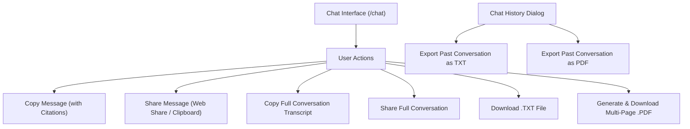

# SmartCollege AI — Chat Sharing and Multi-Format Export System Implementation Report

**Project:** SmartCollege AI (Multi-College Student Chatbot & Administrative Platform)  
**Phase:** Phase 6 — Chat Sharing, Copying, and Exporting System  
**Implementation Date:** November 13, 2026  
**Status:** Complete, Verified, and Production Ready  

---

## 1. Executive Summary

As part of Phase 6, SmartCollege AI features a comprehensive Chat Sharing, Copying, and Multi-Format Export system. This functionality allows students, counselors, and staff to copy answers with source citations, share conversations natively across mobile/desktop platforms, and download formatted consultation transcripts as plain text (`.txt`) or styled multi-page PDF documents (`.pdf`).

All export and sharing utilities operate client-side without sending conversation logs to third-party services, preserving student confidentiality and college data isolation.

---

## 2. Capabilities & Features Implemented



---

## 3. Detailed Component Architecture

### 3.1 Message-Level Copy & Share (`MessageBubble.tsx`)
- **Copy Answer Button:**
  - Located in the assistant message action bar.
  - Formats the assistant's answer with its official university citations, verification date, and verification status.
  - Temporarily swaps the copy icon to a green checkmark for 2 seconds.
  - Triggers a global toast notification: `"Answer copied to clipboard!"`.
- **Share Answer Button:**
  - Invokes `shareMessage(message)`.
  - Attempts native sharing via `navigator.share({ title, text })`.
  - If Web Share is unavailable (e.g. non-HTTPS, unsupported browser) or encounters a non-abort error, it seamlessly falls back to copying the text to clipboard and informs the user: `"Answer copied to clipboard for sharing!"`.

### 3.2 Full Conversation Actions Menu (`ChatWindow.tsx`)
- Located in the top header adjacent to Clear Chat:
  - **Export / Share** button opening a Material UI `Menu`.
  - **Copy Conversation:** Copies the complete chronological transcript of the consultation with institutional headers and query metrics.
  - **Share Conversation:** Native mobile/desktop share with clipboard fallback.
  - **Export as TXT:** Downloads a clean `.txt` document.
  - **Export as PDF:** Generates and downloads a structured multi-page `.pdf` document.

### 3.3 Past Conversations Export from History (`ChatHistoryDialog.tsx`)
- In addition to exporting the active chat, students can export any previously saved conversation from the **Chat History Dialog** without needing to restore it into the active viewport first:
  - Text download icon button (`FileDownloadRoundedIcon`).
  - PDF document icon button (`PictureAsPdfRoundedIcon`).

---

## 4. Multi-Page PDF Generation (`exportUtils.ts`)

PDF generation is implemented using `jspdf` (`2.5.2`) and adheres to formal institutional styling standards:

### 4.1 Document Structure & Aesthetics
- **Geometry:** Standard ISO A4 portrait dimensions (`210mm x 297mm`), with `16mm` margins.
- **Top Decorative Strip:** Institutional primary blue header bar (`#2563EB`).
- **Institutional Header:**
  - Document title: **SmartCollege AI — Consultation Record**
  - Institutional profile name (e.g. `NRI University`, `SRM University-AP`, `General Student Support`).
  - Generated timestamp and query count.
- **Alternating Message Cards:**
  - **Student Queries:** Rendered in light blue callout boxes (`#EFF6FF`) with `#2563EB` left accent borders and a bold `[Student - HH:MM]` header.
  - **Assistant Responses:** Rendered in clean slate boxes (`#F8FAFC`) with `#E2E8F0` borders and `[SmartCollege Assistant - HH:MM]` headers.
- **Official Citations & Metadata:**
  - Verification badges: `[VERIFIED FAQ]` or `[PENDING VERIFICATION]`.
  - Official university source URL and audit verification dates clearly cited beneath verified responses.
- **Dynamic Text Wrapping & Pagination:**
  - Uses `doc.splitTextToSize` with dynamic box height calculations.
  - Automatically breaks across pages when content exceeds printable vertical boundaries.
  - Numbers all pages dynamically: `Page X of Y` in the bottom footer.
  - Appends an official institutional disclaimer:
    `"Official Institutional Consultation Record • Citations Verified • SmartCollege AI"`

---

## 5. TXT Document Formatting (`exportUtils.ts`)

The TXT export produces a clean, human-readable UTF-8 plain text file named with institutional slug and date:
`SmartCollege_<CollegeName>_<YYYY-MM-DD>.txt`

**Sample Output Structure:**
```text
==================================================================
SmartCollege AI — Student Conversation Record
Institution: NRI University
Export Date: 11/13/2026, 10:05:00 AM
Total Messages: 2
==================================================================

[Student - 10:00 AM]
What is the B.Tech CSE fee at NRI University?

------------------------------------------------------------------
[SmartCollege AI (NRI University) - 10:00 AM]
The B.Tech CSE tuition fee at NRI University is INR 75,000 per academic year.

Official Source: https://nriit.edu.in/fee-structure
Verified Date: 2026-11-11
Verification Status: VERIFIED

==================================================================
Generated by SmartCollege AI Assistant
Strict College Isolation • Official Sources Cited
==================================================================
```

---

## 6. Clipboard & Web Share Fallback Architecture

To guarantee reliability across mobile devices, desktop browsers, iframes, and restricted permissions contexts:
1. **Primary Clipboard:** Calls `navigator.clipboard.writeText(text)` inside an `async` flow.
2. **Fallback Clipboard:** If the Clipboard API fails or is blocked by browser security policy, creates an off-screen `<textarea>`, selects the text, and invokes `document.execCommand("copy")`.
3. **Web Share API:** Tests for `navigator.share` availability. If user dismisses/cancels the share picker (`AbortError`), the action completes quietly without throwing errors; on any other failure, it automatically copies the share content to clipboard.

---

## 7. Verification & Automated Testing

- **Unit & Component Testing:** Verified in `frontend/src/__tests__/feedbackAndExport.test.tsx`:
  - `formatSingleMessage`: Confirmed inclusion of author, timestamp, content, source citations, and verified dates.
  - `formatFullConversation`: Confirmed generation of institutional headers, dividers, and message blocks.
  - `exportConversationAsTxt`: Confirmed blob URL creation, link simulation, and DOM cleanup.
  - `exportConversationAsPdf`: Confirmed multi-page `jsPDF` coordinate math, text splitting, page breaks, and footer numbering without errors.
  - Copy & Share actions: Confirmed header menu opening, clipboard write invocation, and toast alerts.
- **Frontend Vitest Suite:** 29 passed across 5 test suites.
- **TypeScript:** 0 errors (`tsc -b`).
- **Production Build:** Succeeded (`npm run build`).

