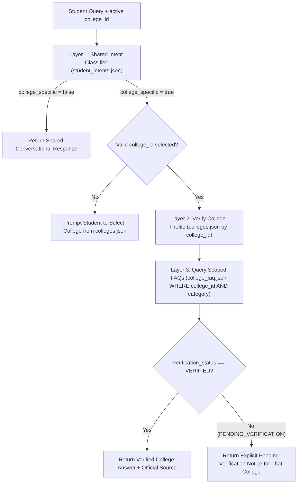

# Multi-College Data Architecture

**Project:** AI-Powered Multi-College Chatbot for Student Queries  
**Architecture Files:**
- `dataset/processed/student_intents.json` *(unchanged shared intent layer)*
- `dataset/processed/colleges.json` *(3 college profiles registry)*
- `dataset/processed/college_faq.json` *(college-isolated FAQ knowledge store)*

**Date:** 2026-11-11

---

## 1. Inspection of Existing Datasets

### 1.1 `dataset/processed/student_intents.json` (Shared NLU Layer)
- **Counts:** 30 intents · 367 cleaned question patterns · 36 placeholder-free fallback/general responses.
- **College-Agnostic Intents (`college_specific: false` — 4 intents):**
  - `general_queries`, `greeting`, `goodbye`, `salutation`
- **College-Specific Intents (`college_specific: true` — 26 intents):**
  - `admissions`, `admission_documents`, `seat_intake`, `courses`, `syllabus`, `examinations`, `fees`, `scholarships`, `placements`, `internships`, `hostel`, `library`, `facilities`, `canteen`, `sports`, `college_location`, `college_hours`, `contact_info`, `campus_events`, `holidays_and_vacations`, `mess_and_bus_timetable`, `department_hod`, `principal_info`, `dress_code`, `student_committees`, `anti_ragging`

### 1.2 `dataset/processed/college_faq.json` (College-Isolated FAQ Store)
- **Isolation Key:** `college_id` (required in every FAQ record).
- **Record Schema (8 fields):** `college_id`, `college_name`, `category`, `question`, `answer`, `source`, `last_verified`, `verification_status`.
- **Current Partitioning:** 42 template records evenly partitioned across 3 colleges (14 core categories per `college_id`), with every unverified item marked `PENDING_VERIFICATION` and zero invented college data.

---

## 2. Scalable Three-Layer Multi-College Architecture

The data layer decouples **language understanding (what the student is asking)** from **institutional knowledge (which college's verified data answers it)**. Onboarding a new college requires adding a profile and FAQ records under a new `college_id`—**no intent duplication or NLP model retraining is required**.

### Layer Responsibilities

| Layer | Data Store | Primary Key / Scope | Purpose |
| --- | --- | --- | --- |
| **Layer 1: Shared Intent Layer** | `dataset/processed/student_intents.json` | `intent` (30 lowercase `snake_case` classes) | Classifies student queries and determines `college_specific` routing |
| **Layer 2: College Profile Registry** | `dataset/processed/colleges.json` | `college_id` (`college_001`, `college_002`, `college_003`) | Stores college identity, supported categories, and structured institutional metadata |
| **Layer 3: College FAQ Knowledge Base** | `dataset/processed/college_faq.json` | `(college_id, category, question)` | Stores per-college verified Q&A entries with `source` and `last_verified` audit trail |

### Scalability Roadmap (3 Colleges → 100+ Colleges)
1. **Current File-Backed Phase (3–20 colleges):** Single `colleges.json` registry + `college_faq.json` indexed in memory by `(college_id, category)`.
2. **Sharded File / Storage Phase (20–100 colleges):** Split FAQs into per-college files `dataset/processed/colleges/<college_id>/faq.json` while keeping the exact same 8-field record contract.
3. **Database / Hybrid Retrieval Phase (100+ colleges):** Migrate `colleges` and `college_faqs` into PostgreSQL/SQLite tables with a composite index `(college_id, category)` and metadata-filtered semantic search (`filter={"college_id": active_college_id}`), ensuring queries never scan or retrieve across tenant boundaries.

---

## 3. College Profiles (`dataset/processed/colleges.json`)

Three college profiles have been prepared with `college_001` (**NRI University**) as the first intended college profile. No real facts, fees, contacts, or statistics have been invented; all unverified institutional fields use the explicit `PENDING_VERIFICATION` marker.

| `college_id` | `college_name` | `short_code` | Primary Profile | Unverified Fields Marked `PENDING_VERIFICATION` |
| --- | --- | --- | --- | --- |
| `college_001` | **NRI University** | `NRIU` | Yes | `fees`, `hostel_fees`, `hod_names`, `principal_name`, `phone_numbers`, `admission_helpline`, `placement_statistics`, `admission_details`, `courses_offered`, `address`, `map_url`, `official_website`, `library_details`, `hostel_details`, `scholarships`, etc. |
| `college_002` | Partner College Profile 2 (Template) | `PENDING_VERIFICATION` | No | All institutional fields (`location`, `contact`, `administration`, `admissions`, `academics`, `fees_and_aid`, `career_services`, `campus_life`) |
| `college_003` | Partner College Profile 3 (Template) | `PENDING_VERIFICATION` | No | All institutional fields (`location`, `contact`, `administration`, `admissions`, `academics`, `fees_and_aid`, `career_services`, `campus_life`) |

---

## 4. College Isolation & Safe College Switching Design

To guarantee students can switch colleges freely without mixing institutional answers or stale conversation context:

1. **Mandatory `college_id` Filter on Every Lookup:**
   - All FAQ and profile queries must filter strictly on `record["college_id"] == request.college_id`.
   - Unscoped global search across `college_faq.json` is disallowed whenever `college_specific == true`.
2. **Composite Cache & Retrieval Keys:**
   - In-memory lookup maps use `(college_id, category)` tuples rather than `category` alone, preventing `college_001` data from ever colliding with `college_002` or `college_003`.
3. **Atomic Context Reset on College Switch:**
   - When the student switches `active_college_id` (e.g., `college_001` → `college_002`), the session manager:
     1. Updates `session.active_college_id = "college_002"`.
     2. Clears transient conversational context (`active_category`, `last_entities`, `cached_college_summary`).
     3. Tags each rendered chat message in the UI history with its originating `college_id` / `college_name` badge so past answers from `NRI University` remain visually distinct from new answers for `college_002`.
4. **No Cross-College Fallback:**
   - If `college_002` lacks verified data for `fees`, the retriever **never** falls back to `college_001` or another college's record; it returns a college-scoped `PENDING_VERIFICATION` response naming `college_002`.
5. **Missing College Guard:**
   - If a student submits a college-specific query before selecting a college (`college_id` is empty/unknown), the router returns the active college options from `colleges.json` and requests selection first.

---

## 5. Sample Question–Answer Retrieval Workflows (Two Colleges)

### Workflow A — Querying `college_001` (NRI University)

1. **College Selection:** Student selects **NRI University** (`college_id: "college_001"`). Session binds `active_college_id = "college_001"`.
2. **Student Query:** `"What is the semester fee structure?"`
3. **Intent Classification (`student_intents.json`):**
   - Matches `intent: "fees"`, `category: "fees"`, `college_specific: true`.
4. **Profile & FAQ Lookup (Strictly Scoped to `college_001`):**
   - Looks up `colleges.json[college_id == "college_001"]` → `college_name: "NRI University"`.
   - Queries `college_faq.json` where `college_id == "college_001"` and `category == "fees"`.
5. **Response Behavior:**
   - **Current unverified state (`verification_status == "PENDING_VERIFICATION"`):**  
     Returns: *"For **NRI University** (`college_001`), tuition and hostel fee details are currently **PENDING_VERIFICATION**. Please check back once official fee circulars are verified."*
   - **Post-verification state (once real fee circular is added):**  
     Returns the verified `answer` from `college_001`'s `fees` FAQ entry along with its official `source` URL and `last_verified` date—completely isolated from `college_002` and `college_003`.

---

### Workflow B — Switching to `college_002` (Partner College Profile 2)

1. **College Switch Event:** Student switches dropdown from `college_001` to `college_002`.
   - Session clears `NRI University` transient context (`active_category = null`, cached slots cleared) and sets `active_college_id = "college_002"`.
2. **Shared General Query Check (Optional Interleaved Query):**
   - Student asks: `"hi"` → `intent: "greeting"`, `college_specific: false`.
   - Handled directly by Layer 1 (`student_intents.json`) without querying `college_faq.json`.
3. **Student College-Specific Query:** `"What are the placement statistics and recruiters?"`
4. **Intent Classification (`student_intents.json`):**
   - Matches `intent: "placements"`, `category: "placements"`, `college_specific: true`.
5. **Profile & FAQ Lookup (Strictly Scoped to `college_002`):**
   - Looks up `colleges.json[college_id == "college_002"]` → `college_name: "Partner College Profile 2 (Template)"`.
   - Queries `college_faq.json` where `college_id == "college_002"` and `category == "placements"`.
   - Note: Even if `college_001` (`NRI University`) already had verified placement statistics populated, this query **only** reads records matching `college_id == "college_002"`.
6. **Response Behavior:**
   - Returns `college_002`'s scoped record (`PENDING_VERIFICATION` until `college_002`'s official placement report is verified, or `college_002`'s verified placement figures once populated), tagged with `college_id: "college_002"`.

---

## 6. Verification Checklist (Current State)

| Check | Status | Details |
| --- | --- | --- |
| Original raw dataset (`intents.json`, `model.h5`) untouched | **Verified** | Zero modifications |
| Cleaned intent patterns (`student_intents.json`) untouched | **Verified** | 30 intents · 367 patterns preserved |
| Three college profiles created with `college_id` | **Verified** | `college_001` (`NRI University`), `college_002`, `college_003` in `dataset/processed/colleges.json` |
| Unverified institutional details marked `PENDING_VERIFICATION` | **Verified** | Fees, HOD names, phone numbers, placement stats, admission details, etc. |
| Zero invented college data | **Verified** | No synthetic fees, contacts, addresses, or placement numbers |
| FAQs strictly isolated by `college_id` | **Verified** | 42 records (14 per `college_id`) in `dataset/processed/college_faq.json` |
| No model trained, no frontend/backend built | **Verified** | Architecture and data preparation only |

