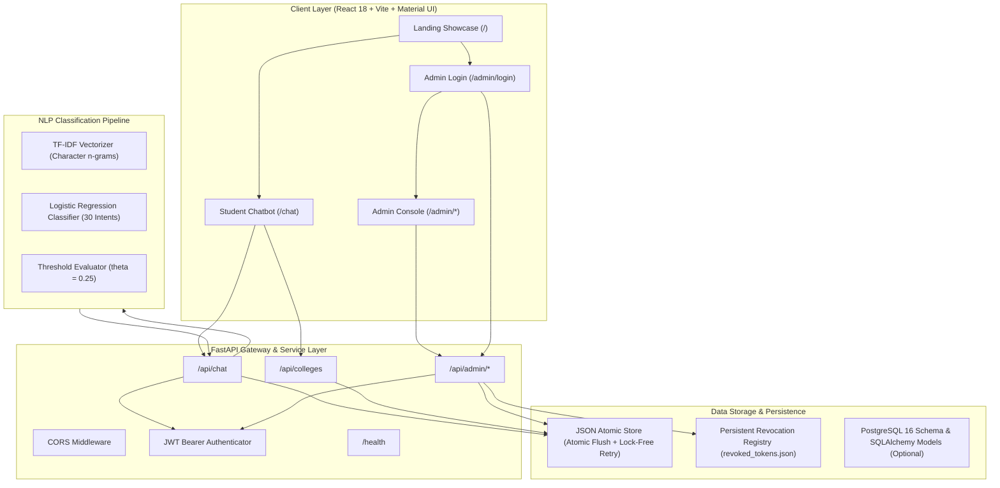
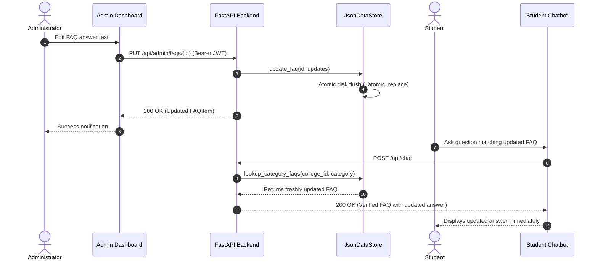

# SmartCollege AI — System Architecture Documentation

**System:** SmartCollege AI (Multi-College Chatbot & Administrative Management Console)  
**Version:** 1.0.0  
**Target Environment:** Python 3.11+ / Node.js 18+  
**Workspace:** `D:\TechGlobal_Mini\AI-Student-Chatbot`  

---

## 1. High-Level Architecture Overview

SmartCollege AI is engineered as a decoupled, multi-tier web application designed to deliver institutional support to prospective and enrolled students while providing an enterprise-grade administrative management console for academic staff.



---

## 2. Decoupled Multi-College Data Architecture

A foundational architectural requirement of SmartCollege AI is **strict multi-institutional isolation**. The machine learning pipeline classifies student intents across domain categories (e.g., admissions, fees, hostel, placements) without baking college-specific strings into model weights.

### 2.1 The Five Registered Institutions
The platform strictly maintains separate institutional profiles and curated FAQ partitions:

1. **NRI University (`college_001`):** Dr. RVR NRI Institute of Technology (Agiripalli, Eluru District, AP).
2. **SRM University-AP (`college_002`):** SRM University-AP (Neerukonda, Mangalagiri, AP).
3. **KL Deemed to be University (`college_003`):** Koneru Lakshmaiah Education Foundation (Vaddeswaram, Guntur District, AP).
4. **Siddhartha Academy of Higher Education (`college_004`):** SAHE (Kanuru, Vijayawada, AP).
5. **Prasad V Potluri Siddhartha Institute of Technology (`college_005`):** PVPSIT (Kanuru, Vijayawada, AP).

> [!IMPORTANT]
> **SAHE (`college_004`) and PVPSIT (`college_005`) Non-Merger Guarantee:**
> Although both institutions share historical legacy ties with the Siddhartha Academy sponsoring body in Vijayawada, they operate under distinct administrative charters, independent university accreditations, and separate official portals (`siddhartha.edu.in` vs. `pvpsiddhartha.ac.in`). SmartCollege AI strictly isolates their datasets, profiles, and queries.

### 2.2 FAQ Storage Schema
Each FAQ record strictly adheres to the following data contract:
```json
{
  "id": 1,
  "college_id": "college_001",
  "college_name": "NRI University",
  "category": "general_information",
  "question": "What is the official name and recognition status of NRI University?",
  "answer": "NRI University is officially named Dr. RVR NRI Institute of Technology...",
  "source": "https://rvrnriuniversity.edu.in/about-us/",
  "last_verified": "2026-11-11",
  "verification_status": "VERIFIED"
}
```

---

## 3. NLP Intent Recognition Pipeline

The natural language processing engine operates independently from college dataset records:

1. **Vectorization:** Character n-gram TF-IDF vectorizer (`ngram_range=(2, 5)`, sublinear TF scaling). Character n-grams ensure robust handling of spelling variants, compound words, and student typographical quirks.
2. **Classification:** Multi-class Logistic Regression with balanced class weights covering 30 student intents.
3. **Confidence Scorer & Gatekeeper:**
   - Confidence threshold: $\theta = 0.25$.
   - If $\max P(\text{intent}) < \theta$, the query is classified as `UNKNOWN` and handled gracefully with suggested exploratory chips.
   - If the predicted intent is a general conversational intent (e.g., `greeting`, `help`), it is answered immediately without requiring college selection.
   - If the predicted intent is institutional (e.g., `fees`, `hostel`, `placements`), a valid `college_id` is mandatory; otherwise, the API returns HTTP 400 (`MISSING_COLLEGE_ID`).

---

## 4. FastAPI Backend Architecture

The backend is built with FastAPI and organized into distinct functional layers:

- **Router Layer (`backend/app/routes/`):**
  - `health.py`: Liveness, readiness, and metrics.
  - `colleges.py`: College profiles, selection context, and FAQ browser endpoints.
  - `chat.py`: Public student query endpoint executing intent classification and FAQ matching.
  - `admin_auth.py`: Admin sign-in, token issuance, identity inspection, and persistent revocation.
  - `admin.py`: Protected administrative CRUD operations for colleges and FAQs.
- **Service Layer (`backend/app/services/`):**
  - `ChatbotService`: Central orchestrator coordinating intent classification, college scoping, and FAQ scoring.
  - `JsonDataStore`: Thread-safe, lock-free, atomic JSON storage with automated file replacement.
  - `PostgresDataStore`: Prepared SQLAlchemy 2.0 repository for relational migration.
- **Security & Middleware Layer (`backend/app/utils/`):**
  - `admin_auth.py`: Cryptographic PBKDF2-SHA256 password hashing and HS256 JWT signature verification.
  - `dependencies.py`: Reusable FastAPI dependencies (`get_current_admin_user`, `get_chatbot_service`).
  - Persistent Revocation Store: Disk-persisted blacklist in `backend/app/data/revoked_tokens.json`.

---

## 5. React Frontend Architecture

The frontend is constructed using React 18, TypeScript, Material UI (MUI v6), and Vite:

- **State Management & Contexts (`frontend/src/contexts/`):**
  - `CollegeContext`: Manages active college selection, loaded institutional details, and resets conversation context on college switch.
  - `AdminAuthContext`: Manages JWT access tokens, active admin identity, automatic session restoration from `localStorage`, and logout cleanup.
- **Navigation & Layout Shells (`frontend/src/layouts/`):**
  - `MainLayout`: Student experience shell featuring responsive sidebar drawer, brand identity, college selector, and active institutional metadata card.
  - `AdminLayout`: Admin console shell featuring a persistent/temporary responsive drawer, administrator identity badge, route navigation, and secure sign-out confirmation.
- **Route Architecture (`frontend/src/App.tsx`):**
  - `/`: Public landing page showcasing registered colleges, feature cards, and direct CTAs.
  - `/chat`: Student conversational portal with voice recognition, chat history, and suggested queries.
  - `/admin/login`: Dedicated administrator authentication page.
  - `/admin`: Protected dashboard overview with real-time institutional KPI cards.
  - `/admin/colleges`: Protected college profile management and editing console.
  - `/admin/faqs`: Protected FAQ table with live multi-criteria filtering, search, pagination, and status toggles.
  - `AdminProtectedRoute`: Route wrapper enforcing valid authentication and redirecting unauthenticated users to `/admin/login`.

---

## 6. Real-Time Data Synchronization Architecture

SmartCollege AI guarantees that administrative edits immediately reflect in student query responses:



