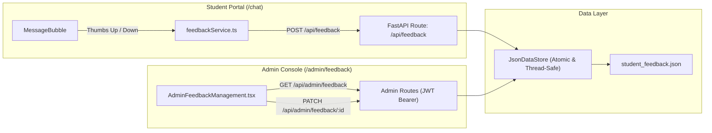

# SmartCollege AI — Student Answer Feedback System Implementation Report

**Project:** SmartCollege AI (Multi-College Student Chatbot & Administrative Platform)  
**Phase:** Phase 6 — Student Feedback System  
**Implementation Date:** November 13, 2026  
**Status:** Complete, Verified, and Production Ready  

---

## 1. Executive Summary

Phase 6 implements an end-to-end Student Answer Feedback System for SmartCollege AI. The feedback system enables students to rate any chatbot response as helpful (thumbs up) or report an issue (thumbs down) with categorized reasons and optional descriptive comments.

For institutional administrators, a dedicated console at `/admin/feedback` provides real-time satisfaction analytics, multi-criteria filtering, full Q&A inspection dialogs, and a four-stage resolution workflow (`NEW`, `REVIEWED`, `RESOLVED`, `DISMISSED`) with audit notes.

All feedback records are persisted in a thread-safe, atomic JSON data store (`backend/app/data/student_feedback.json`) without requiring student logins or collecting personally identifiable information (PII).

---

## 2. Architecture & Design Principles

### Key Design Pillars:
1. **Privacy-Preserving & Low-Friction:** Students do not need an account or login to provide feedback. A persistent client session token (`smartcollege_student_session_id`) is stored in `localStorage` to identify feedback per browser session without tracking personal identities.
2. **Spam & Duplicate Prevention:** The backend checks the composite tuple `(session_id, message_id)`. If a student re-rates an answer or alters their comment, the system updates the existing feedback record in-place rather than inserting duplicates.
3. **Strict College Scoping:** Every feedback entry is tagged with its originating `college_id` and `college_name`, ensuring administrators can audit feedback by campus without data blending.
4. **Resilient Persistence:** Uses atomic sequential file writes with temporary files and exponential backoff retry to prevent corruption under concurrent write access on Windows NTFS filesystems.

---

## 3. Student Portal Implementation (`frontend`)

### 3.1 Interaction Components (`MessageBubble.tsx`)
- **Helpful Rating (Thumbs Up):**
  - Clicking the thumbs up button submits `rating: "thumbs_up"` immediately via `feedbackService.submitFeedback()`.
  - The message state updates instantly to display a green "Helpful" chip with filled icon.
  - Success notification: `"Thank you! Your feedback helps improve institutional answers."`
- **Issue Reporting (Thumbs Down):**
  - Clicking the thumbs down button opens a clean, focused modal dialog titled **"Help Us Improve"**.
  - Provides five standard feedback reason selections:
    1. `Incorrect answer`
    2. `Outdated information`
    3. `Irrelevant answer`
    4. `Incomplete answer`
    5. `Other`
  - Provides an optional multiline comment field (`"Tell us more about what was incorrect or missing..."`).
  - Submitting sends `rating: "thumbs_down"`, the chosen reason, and comments.
  - Updates message state to display an amber/red "Reported" chip.
  - Success notification: `"Feedback received! Institutional administrators will review this query."`

### 3.2 State & Session Management
- **Persistent Session Identification:**
  - `getOrCreateSessionId()` in `frontend/src/utils/chatHistoryStorage.ts` generates a UUID or cryptographically random identifier stored under `smartcollege_student_session_id`.
- **In-Memory & Storage Synchronization:**
  - `useChatSession` hook provides `updateMessageFeedback(messageId, feedback)` which immediately updates the message in state and commits the snapshot to `localStorage` (`smartcollege_ai_chat_history_v1`), preserving rating chips across page refreshes.

---

## 4. Administrative Feedback Management Console (`/admin/feedback`)

### 4.1 Overview & Metrics
The console displays four responsive KPI metric cards:
- **Total Feedback:** Aggregate count of all submitted ratings across colleges.
- **Positive Ratings:** Count of thumbs-up evaluations.
- **Issue Reports:** Count of thumbs-down evaluations requiring staff attention.
- **Student Satisfaction:** Calculated positive satisfaction ratio (`(positive / total) * 100`).

### 4.2 Multi-Criteria Filtering & Search
Administrators can filter feedback in real-time across five dimensions:
- **Search Keyword:** Matches substrings across student questions, bot responses, and student comments.
- **College Selector:** Filter by all colleges or specific institutional profiles.
- **Rating Selector:** Filter by Positive (`thumbs_up`) or Negative (`thumbs_down`).
- **Review Status:** Filter by `NEW`, `REVIEWED`, `RESOLVED`, or `DISMISSED`.
- **Reason Category:** Filter by specific report reasons (e.g., `Outdated information`).

### 4.3 Detailed Q&A Inspection & Status Workflow
Clicking the inspection icon opens a full modal:
- **Student Question:** The exact prompt submitted by the student.
- **Bot Response:** Full text of the answer delivered by the assistant.
- **Metadata Badges:** College badge, NLP intent chip, and rating chip with reason.
- **Student Comment:** Highlighted in red callout card when present.
- **Status Selector:** One-click transition between:
  - `NEW`: Awaiting administrative review.
  - `REVIEWED`: Under investigation with college department.
  - `RESOLVED`: Verified FAQ record updated or corrected.
  - `DISMISSED`: Query determined to be non-actionable or invalid.
- **Administrative Notes:** Internal textarea for institutional staff to record resolution details.

---

## 5. Backend Implementation (`backend`)

### 5.1 Endpoints Implemented

| Method | Endpoint | Access | Purpose |
| :--- | :--- | :--- | :--- |
| `POST` | `/api/feedback` | Public | Submit or update student rating, reason, and comment |
| `GET` | `/api/admin/feedback/stats` | Protected (JWT) | Retrieve aggregate feedback metrics and breakdowns |
| `GET` | `/api/admin/feedback` | Protected (JWT) | Paginated, filterable, and searchable feedback records |
| `PATCH` | `/api/admin/feedback/{feedback_id}` | Protected (JWT) | Update review status and attach administrative notes |

### 5.2 Schemas & Data Models (`backend/app/utils/schemas.py`)
- `FeedbackSubmitRequest`: Input payload validating `session_id`, `message_id`, `college_id`, `question`, `answer`, `rating` (`thumbs_up` | `thumbs_down`), `reason`, `comment`.
- `FeedbackRecord`: Complete stored record with timestamps, UUID `feedback_id`, `status` (`NEW` | `REVIEWED` | `RESOLVED` | `DISMISSED`), and `admin_notes`.
- `AdminFeedbackStatsResponse`: Summary counts, satisfaction percentage, and dictionaries broken down by college, reason, and status.
- `AdminFeedbackUpdateRequest`: Validates `status` and `admin_notes` updates.

### 5.3 Storage & Persistence (`backend/app/services/data_store.py`)
- **Storage Location:** `backend/app/data/student_feedback.json`
- **Thread Safety:** Python `threading.Lock` guards all read and write operations.
- **Atomic File Commits:** Writes to a unique temporary file (`student_feedback.tmp.<uuid>.json`), followed by `os.replace` to eliminate partial file writes.
- **Windows File Locking Backoff:** Implements exponential backoff retry (`PermissionError` / `WindowsError 32`) to withstand concurrent file access.

---

## 6. Verification & Results

- **Backend Pytest Coverage:** 5 dedicated tests in `backend/tests/test_feedback_api.py` verifying submission, duplicate updating, authentication protection, status editing, and restart persistence.
- **Full Backend Regression:** 116 tests passing, 0 failures.
- **Frontend Vitest Coverage:** Component tests in `frontend/src/__tests__/feedbackAndExport.test.tsx` verifying thumbs up, thumbs down dialog, radio reason select, comment typing, and admin status updates.
- **Full Frontend Regression:** 29 tests passing across 5 test suites.
- **TypeScript:** 0 errors (`tsc -b`).
- **Production Build:** Succeeded with zero bundle errors (`npm run build`).

