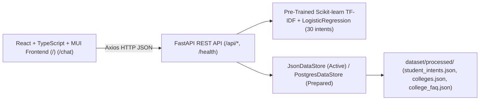

# System Integration Report

**Project:** AI-Powered Multi-College Chatbot for Student Queries  
**Phase:** Phase 4 — Complete System Integration and Final Validation  
**Date:** 2026-11-11  
**Overall Integration Status:** Integrated, Verified End-to-End, and Ready for Local Demonstration

---

## 1. End-to-End System Architecture

The integrated application connects four decoupled layers inside [`AI-Student-Chatbot/`](../):

### Layer Summary
1. **Processed Data & Multi-College Architecture ([`dataset/`](../dataset)):**
   - Raw datasets ([`intents.json`](../dataset/raw/intents.json) — 39 intents / 412 patterns / 50 responses, and [`model.h5`](../dataset/raw/model.h5)) remain completely unmodified and unused by the runtime pipeline.
   - [`student_intents.json`](../dataset/processed/student_intents.json) holds 30 cleaned `snake_case` intents (26 `college_specific: true`, 4 `college_specific: false`), 367 deduplicated question patterns, and 36 conversational/guidance responses.
   - [`colleges.json`](../dataset/processed/colleges.json) registers 3 institutions (`college_001`, `college_002`, `college_003`).
   - [`college_faq.json`](../dataset/processed/college_faq.json) holds 56 college-scoped FAQ records partitioned strictly by `college_id`.
2. **Pre-Trained NLP Intent Classifier ([`backend/app/models/`](../backend/app/models)):**
   - Uses [`TfidfVectorizer`](../backend/app/models/tfidf_vectorizer.joblib) (`char_wb`, n-grams `3–5`, `sublinear_tf=True`) and [`LogisticRegression`](../backend/app/models/intent_classifier.joblib) (`C=10.0`, `max_iter=1000`) evaluated in [`model_metadata.json`](../backend/app/models/model_metadata.json) (`91.89%` hold-out accuracy across 74 test samples, `0.8982` macro F1, `0.9042` weighted F1).
   - Loaded read-only at runtime via [`IntentClassifier`](../backend/app/services/intent_classifier.py) with `DEFAULT_CONFIDENCE_THRESHOLD = 0.25`. Predictions below threshold are routed cleanly as `intent = "unknown"` without hitting FAQ records.
3. **FastAPI Backend ([`backend/`](../backend)):**
   - [`main.py`](../backend/app/main.py) initializes `ChatbotService`, OpenAPI docs (`/docs`), CORS middleware, domain exception handlers, and routers ([`health.py`](../backend/app/routes/health.py), [`colleges.py`](../backend/app/routes/colleges.py), [`chat.py`](../backend/app/routes/chat.py)).
   - [`ChatbotService`](../backend/app/services/chatbot_service.py) enforces strict `college_id` validation (`404 INVALID_COLLEGE_ID`), missing college guard on college-specific intents (`400 MISSING_COLLEGE_ID`), empty input checks (`400 EMPTY_QUESTION`), `(college_id, category)` FAQ lookup + intra-slice TF-IDF ranking, explicit `PENDING_VERIFICATION` fallback notices, and cross-college runtime isolation checks.
   - [`database.py`](../backend/app/utils/database.py) and [`postgres_repository.py`](../backend/app/services/postgres_repository.py) provide prepared SQLAlchemy 2.0 ORM tables (`colleges`, `college_faqs`, `chat_query_logs`) with matching `FAQDataStoreProtocol` methods while active runtime uses `FAQ_BACKEND=json`.
4. **React Frontend ([`frontend/`](../frontend)):**
   - Configured via `VITE_API_BASE_URL` ([`.env.example`](../frontend/.env.example), [`.env`](../frontend/.env)) through Axios [`apiClient`](../frontend/src/services/api.ts).
   - [`LandingPage`](../frontend/src/pages/LandingPage.tsx) (`/`) presents overview cards, college preview cards populated from `GET /api/colleges`, and **Get Started** navigation to `/chat`.
   - [`ChatPage`](../frontend/src/pages/ChatPage.tsx), [`MainLayout`](../frontend/src/layouts/MainLayout.tsx), [`Sidebar`](../frontend/src/components/Sidebar.tsx), [`ChatWindow`](../frontend/src/components/ChatWindow.tsx), [`CollegeContext`](../frontend/src/contexts/CollegeContext.tsx), and [`useChatSession`](../frontend/src/hooks/useChatSession.ts) synchronize college selection, reset conversation context cleanly on college switch (`contextVersion`), render `VERIFIED` answers with source URLs/dates, display explicit `PENDING_VERIFICATION` / `UNKNOWN` guidance, expose a college-scoped FAQ directory modal, and adapt cleanly across desktop and mobile viewports.

---

## 2. Integrated REST API Contracts Verified Live

| Method & Path | Verified Role | Status Codes Tested |
| :--- | :--- | :--- |
| `GET /` | Service metadata & discovery links | `200` |
| `GET /health` | Readiness (`status: "ok"`, `num_intents: 30`, `active_faq_backend: "json"`, `total_colleges: 3`) | `200` |
| `GET /api/colleges` | Lists `college_001` (15 verified / 13 pending), `college_002` (0 / 14), `college_003` (0 / 14) | `200` |
| `POST /api/colleges/select` | Switches active college with `context_reset: true` and `supported_categories` | `200`, `404` (`INVALID_COLLEGE_ID`) |
| `GET /api/colleges/{college_id}` | Returns isolated college profile & official source URLs | `200`, `404` (`INVALID_COLLEGE_ID`) |
| `GET /api/colleges/{college_id}/faqs` | Returns strictly college-filtered FAQ records with optional `category` and `verification_status` | `200`, `404` (`INVALID_COLLEGE_ID`) |
| `POST /api/chat` | Runs NLP intent classification and returns `general`, `verified_faq`, `pending_verification`, or `unknown` payload | `200`, `400` (`EMPTY_QUESTION`, `MISSING_COLLEGE_ID`), `404` (`INVALID_COLLEGE_ID`) |

---

## 3. Issues Discovered & Resolved During Phase 4 Integration

1. **Curated Suggestion Chip Phrasing Mismatch ([`constants.ts`](../frontend/src/utils/constants.ts)):**
   - **Finding:** During live E2E integration against the frozen 30-intent model, the curated `"Admissions process"` chip initially sent `"How can I apply for admissions?"`, which scored `0.2269` (`< 0.25` threshold) and fell back to `unknown` instead of triggering `admissions`. Meanwhile `"Hello, what can you help me with?"` resolved to `general_queries` (`0.5527`) rather than `"greeting"`.
   - **Resolution (No NLP Retraining):** Updated the curated `"Admissions process"` suggestion question in [`constants.ts`](../frontend/src/utils/constants.ts) to `"How can I apply for admission?"` (`admissions`, confidence `0.3333`, matches the verified NRIUCET 2026 admissions FAQ) and corrected the general chip category metadata to `"general_queries"`. Re-verified via Vitest, `tsc -b`, `vite build`, and live headless Chrome E2E.
2. **Repository Environment Exclusion ([`.gitignore`](../.gitignore)):**
   - **Finding:** No root `.gitignore` file was present to guard local `.env` files, `node_modules/`, `dist/`, or Python caches.
   - **Resolution:** Added root [`.gitignore`](../.gitignore) while preserving committed [`.env.example`](../backend/.env.example) and [`frontend/.env.example`](../frontend/.env.example) templates.

---

## 4. Security Audit Findings

- **Credentials & Environment Variables:** No secrets or API keys exist in source code or env files. `backend/.env` is omitted; [`backend/.env.example`](../backend/.env.example) leaves `DATABASE_URL` commented as a local template. [`frontend/.env`](../frontend/.env) stores only the non-sensitive local API URL (`VITE_API_BASE_URL=http://127.0.0.1:8000`).
- **CORS Policy ([`main.py`](../backend/app/main.py)):** Configured with `allow_origins=["*"]`, `allow_credentials=False`, and `allow_methods=["GET", "POST", "OPTIONS"]`. Setting `allow_credentials=False` prevents credentialed cross-origin misuse during local multi-origin development; restricting `allow_origins` via environment configuration is recommended before public production deployment.
- **Input Validation & SQL Safety:** Request payloads use Pydantic v2 constraints (`confidence_threshold` in `[0.0, 1.0]`, `college_id` `min_length=1`, `Literal` status query enum). Prepared PostgreSQL queries in [`postgres_repository.py`](../backend/app/services/postgres_repository.py) use parameterized SQLAlchemy ORM expressions. Note: `ChatRequest.question` has no explicit `max_length` limit (tracked as a low-risk hardening recommendation).
- **Error Handling & XSS Protection:** Global unhandled exceptions in [`main.py`](../backend/app/main.py) return sanitized `INTERNAL_SERVER_ERROR` JSON without tracebacks. Frontend [`MessageBubble`](../frontend/src/components/MessageBubble.tsx) and [`ChatWindow`](../frontend/src/components/ChatWindow.tsx) render plain React text nodes (zero `dangerouslySetInnerHTML`) and restrict clickable links via [`splitTextWithLinks`](../frontend/src/utils/formatters.ts) / `isHttpUrl` (`http://`, `https://`, `mailto:`) with `rel="noopener noreferrer"`.
- **Strict College Isolation:** Verified both in unit tests and live headless Chrome that `college_001` answers never leak when switching to `college_002` or `college_003`, and invalid/missing `college_id` errors are raised explicitly.

---

## 5. Known Limitations & Future Improvements

- **Pending Institutional Data:** `college_002` and `college_003` remain template profiles (`PENDING_VERIFICATION`), and 13 categories for `college_001` (such as fees, scholarships, hostel, placements, internships, HODs, exam timetables) await verified official institutional circulars before publishing answers.
- **Persistence Mode:** Active runtime uses read-only JSON storage (`FAQ_BACKEND=json`); enabling PostgreSQL persistence requires configuring `FAQ_BACKEND=postgres`, `DATABASE_URL`, schema initialization via `init_postgres_schema`, and JSON sync via `PostgresDataStore.sync_from_json_data`.
- **Stateless Client Session History:** Frontend conversation history stays in React session memory and intentionally resets on page reload, **Clear Chat**, or college switch.
- **Future Enhancements:** Add request length / rate limiting on `POST /api/chat`, restrict production CORS origins via settings, add official verified records for `college_002`/`college_003`, and consider expanding student intent patterns in a later dataset iteration if broader conversational phrasing is required.

