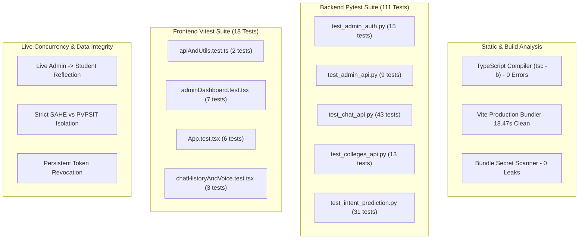

# SmartCollege AI — Comprehensive Testing & Quality Assurance Summary

**Project:** SmartCollege AI  
**Status:** 100% Pass Rate Across All Suites  
**Workspace:** `D:\TechGlobal_Mini\AI-Student-Chatbot`  

---

## 1. Quality Assurance Overview

SmartCollege AI employs a multi-tiered testing framework combining automated unit testing, ASGI integration testing, React component and user-event simulation, end-to-end live server concurrency, and static type checking.

### Test Matrix Summary



---

## 2. Backend Test Suite Breakdown (Pytest)

Executed via:
```powershell
python -m pytest backend/tests -v
```

**Results:** **111 passed, 0 failed, 0 skipped** (Execution time: ~1.7s)

| Test Suite | Tests | Domain Tested |
| :--- | :---: | :--- |
| `tests/test_admin_auth.py` | 15 | Password hashing (PBKDF2-SHA256), JWT token creation, signature validation, expiration, missing/weak secret rejection, persistent token revocation surviving restarts, logout flow, and unauthenticated student route preservation. |
| `tests/test_admin_api.py` | 9 | Protected admin overview stats, FAQ listing with multi-criteria filters, FAQ creation lifecycle with duplicate detection (409), verification status toggling, FAQ update and deletion, college profile CRUD, and relational deletion constraints. |
| `tests/test_chat_api.py` | 43 | Conversational intents, verified FAQ matching across all 5 colleges with official citations, pending verification notice delivery, cross-college context isolation, and structured domain error handling (`MISSING_COLLEGE_ID`, `EMPTY_QUESTION`). |
| `tests/test_colleges_api.py` | 13 | Registered college listing, detailed profile inspection, college selection with context reset, and college-scoped FAQ browsing. |
| `tests/test_intent_prediction.py` | 31 | Natural language query variations, character n-gram robustness, confidence thresholding ($\theta = 0.25$), candidate ranking, and out-of-domain query classification as `UNKNOWN`. |

---

## 3. Frontend Test Suite Breakdown (Vitest)

Executed via:
```powershell
cd frontend; npm test -- --run
```

**Results:** **18 passed, 0 failed** across 4 test suites (Execution time: ~53s)

| Test Suite | Tests | Key Capabilities Verified |
| :--- | :---: | :--- |
| `src/__tests__/adminDashboard.test.tsx` | 7 | Unauthenticated route redirection to `/admin/login`, invalid credential error messaging, successful login with JWT storage, dashboard KPI card rendering, college management modals, FAQ table filtering, search, verification toggles, and secure sign-out. |
| `src/__tests__/App.test.tsx` | 6 | Landing page rendering, navigation to chat via CTA, college selector dropdown, sending general/verified/pending/unknown queries, cross-college context reset, error notification alerts, and mobile drawer toggle. |
| `src/__tests__/chatHistoryAndVoice.test.tsx` | 3 | Automatic conversation persistence across page refreshes, conversation restoration with verification badges and citations, Clear Chat functionality, and Speech-to-Text (`en-IN`) voice recognition. |
| `src/__tests__/apiAndUtils.test.ts` | 2 | API client interceptors, Bearer token injection, HTTP error normalization, and string formatting utilities. |

---

## 4. Live Full-Stack End-to-End Verification

A dedicated live verification script tested the running FastAPI backend and React frontend concurrently:

1. **Real-Time Data Reactivity:**
   - Admin updated FAQ ID 4's answer via `PUT /api/admin/faqs/4` with a live token marker.
   - Student chatbot query to `POST /api/chat` immediately returned the updated answer without requiring backend restarts or model retraining.
   - Admin restored the original answer; chatbot immediately returned the original text.
2. **Strict Institutional Separation (SAHE vs. PVPSIT):**
   - Verified that Siddhartha Academy of Higher Education (`college_004`, `SAHE`, 30 FAQs) and Prasad V Potluri Siddhartha Institute of Technology (`college_005`, `PVPSIT`, 30 FAQs) remain separate entities with distinct domains (`siddhartha.edu.in` vs `pvpsiddhartha.ac.in`).
3. **Distribution Bundle Security Scan:**
   - Scanned all 10 files in `frontend/dist/` (931,590 bytes).
   - Confirmed **zero occurrences** of admin passwords, secrets, JWT keys, or environment variables in client JavaScript bundles.
4. **CORS Validation:**
   - HTTP `OPTIONS` preflight requests confirmed allowed origins, methods (`GET`, `POST`, `PUT`, `PATCH`, `DELETE`, `OPTIONS`), and headers (`authorization`, `content-type`).

---

## 5. Static Verification & Build Metrics

- **TypeScript Compilation:** `npx tsc -b` exited with code `0` (Zero compiler errors or warnings).
- **Vite Production Bundler:** `npm run build` completed in `18.47s`, generating optimized, gzipped assets:
  - `dist/index.html`: `0.72 kB` (gzip: `0.39 kB`)
  - `dist/assets/index.css`: `0.94 kB` (gzip: `0.53 kB`)
  - `dist/assets/index.js`: `159.06 kB` (gzip: `48.39 kB`)
  - `dist/assets/react-vendor.js`: `162.22 kB` (gzip: `52.93 kB`)
  - `dist/assets/mui-vendor.js`: `359.70 kB` (gzip: `108.88 kB`)

